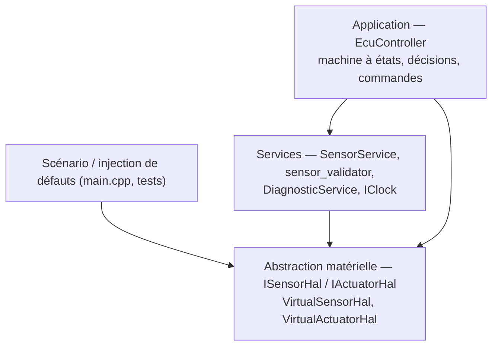
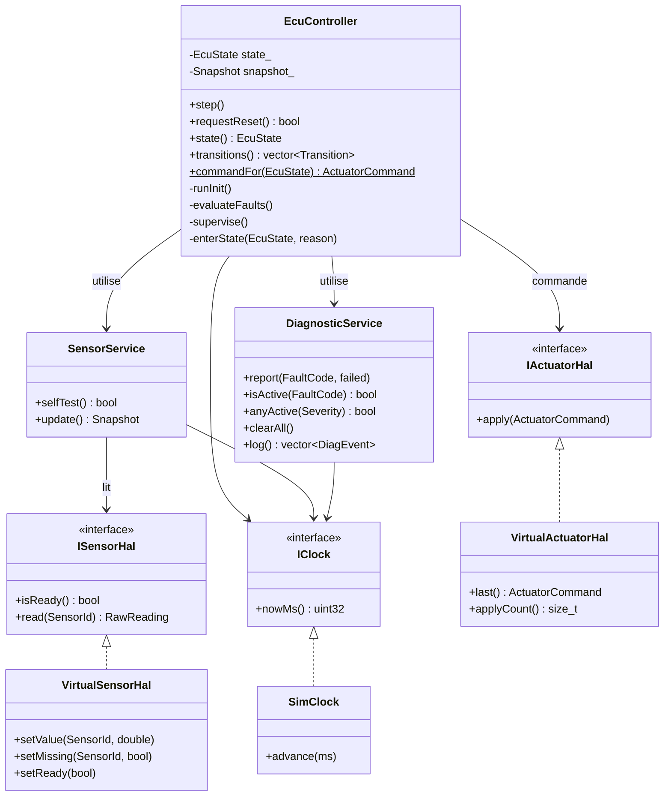
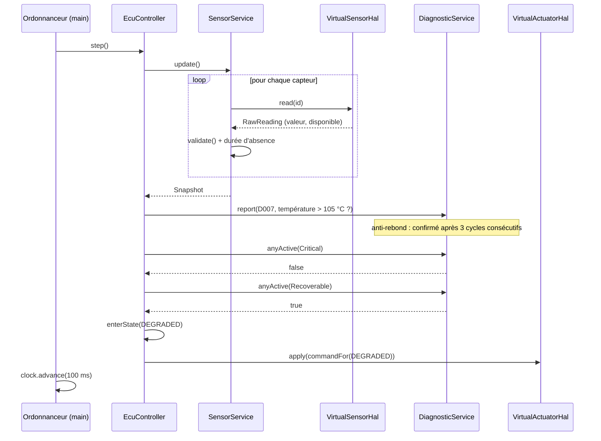

# Architecture

> Architecture **pédagogique inspirée d'AUTOSAR**. Ce n'est pas une implémentation
> (ni certifiée, ni conforme) de la norme AUTOSAR Classic.

## 1. Couches

Règle : une couche ne dépend que de la couche inférieure, et uniquement via des
**interfaces** (`ISensorHal`, `IActuatorHal`, `IClock`). Remplacer la HAL simulée
par une HAL STM32/ESP32 ne demanderait aucune modification de l'application.

## 2. Diagramme UML de classes

## 3. Diagramme de séquence — un cycle de 100 ms (cas : surchauffe)

## 4. Correspondance avec les concepts AUTOSAR (à titre pédagogique)

| Ce projet | Concept AUTOSAR Classic proche | Écart assumé |
|---|---|---|
| `ISensorHal` / `IActuatorHal` + implémentations virtuelles | ECU Abstraction / MCAL (accès matériel) | Pas de drivers réels, pas d'IoHwAb standardisé |
| `EcuController` | Composant logiciel applicatif (SWC) | Pas de description ARXML |
| `EcuController::step()` | Runnable cyclique (100 ms) | Appelé par une boucle simple, pas par un OS OSEK/AUTOSAR |
| `DiagnosticService` (anti-rebond, gravité, journal) | Dem (Diagnostic Event Manager) simplifié | Pas d'UDS, pas de snapshot/extended data, codes fictifs |
| `IClock`, boucle périodique, timeouts | Os counters/alarms, timeouts de signal | Temps simulé déterministe |
| Injection des dépendances dans `main` / tests | Rôle du RTE (câblage des ports) | Câblage manuel, pas de génération de code |
| Non implémenté | NvM, Com/CAN stack, BswM, EcuM, SafeE, Det | Hors périmètre |
