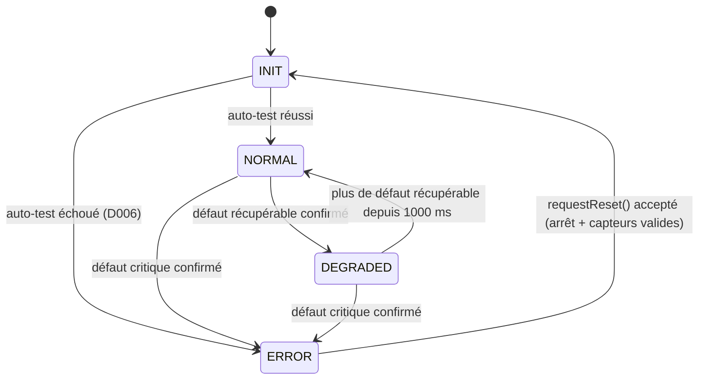

# Machine à états

## Table de transitions

| État | Condition | Nouvel état | Raison journalisée |
|---|---|---|---|
| INIT | `selfTest()` OK | NORMAL | `init ok` |
| INIT | `selfTest()` KO | ERROR | `init failed` |
| NORMAL | défaut récupérable actif | DEGRADED | `recoverable fault` |
| NORMAL / DEGRADED | défaut critique actif | ERROR | `critical fault` |
| DEGRADED | aucun défaut récupérable pendant `kRecoveryTimeMs` | NORMAL | `recovered` |
| ERROR | `requestReset()` avec vitesse ≤ 1 km/h et 3 capteurs valides | INIT | `explicit reset` |
| ERROR | mesure redevenue normale | ERROR | (aucune : pas de sortie automatique) |

## Commandes simulées par état

| État | Voyant | Couple demandé |
|---|---|---|
| INIT | OFF | 0 % |
| NORMAL | OFF | 50 % |
| DEGRADED | ON | 20 % |
| ERROR | ON | 0 % |

Valeurs fictives de simulation, non calibrées pour un véhicule réel.

## Table des défauts (codes propres au projet)

| Code | Défaut | Gravité | Confirmation | Guérison |
|---|---|---|---|---|
| D001 | Température hors plage [0 ; 120] | Récupérable | 3 cycles | 3 cycles |
| D002 | Pression d'huile hors plage [0 ; 10] | Critique | 3 cycles | 3 cycles |
| D003 | Vitesse hors plage [0 ; 200] | Récupérable | 3 cycles | 3 cycles |
| D004 | Donnée capteur invalide (NaN/inf) ou absente | Récupérable | 3 cycles | 3 cycles |
| D005 | Capteur absent ≥ 500 ms (timeout) | Critique | 1 cycle | 3 cycles |
| D006 | Initialisation échouée | Critique | 1 cycle | 3 cycles |
| D007 | Surchauffe : température valide > 105 °C | Récupérable | 3 cycles | 3 cycles |
| D008 | Pression < 1 bar alors que vitesse > 10 km/h (plausibilité) | Critique | 3 cycles | 3 cycles |

Cycle = 100 ms. Ces seuils sont des hypothèses pédagogiques (`include/common/config.hpp`).
